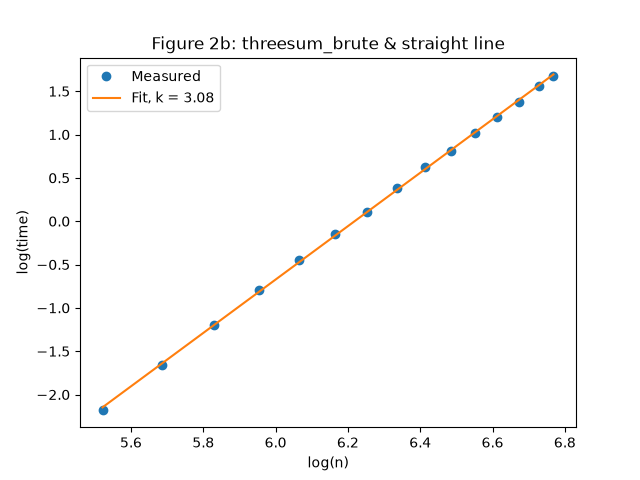
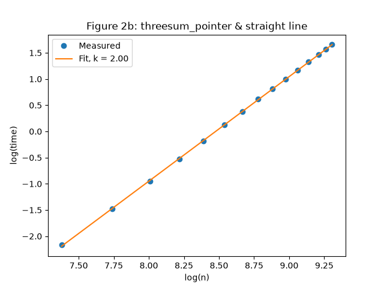
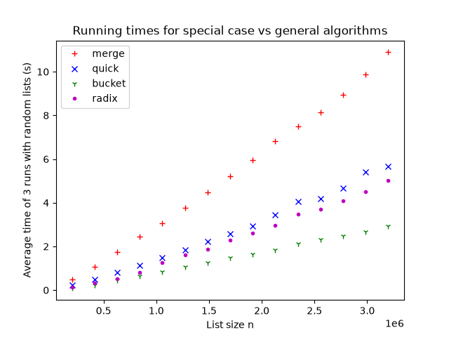
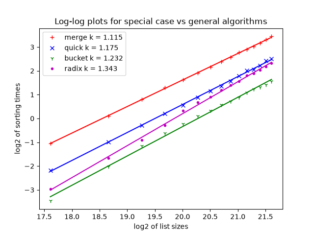

# Time Complexity Experiments

Python implementations of 3-sum and seven sorting algorithms, with experiments that measure their running times and estimate each algorithm's time complexity using log-log regression.

Coursework for 1DV018 Algorithms and Data Structures, Linnaeus University.

## Results

Assuming the running time grows like $T = c \cdot n^k$, taking the log of both sides gives a straight line, $\log(T) = \log(c) + k \cdot \log(n)$. The slope $k$ is the growth rate, while $c$ (how fast the computer is) only moves the line up or down. Linear regression (least squares) on $\log(n)$ and $\log(T)$ gives $k$:

| Algorithm         | Expected          | Measured k |
| ----------------- | ----------------- | ---------- |
| 3-sum brute force | $O(n^3)$          | 3.08       |
| 3-sum two-pointer | $O(n^2)$          | 2.00       |
| Selection sort    | $O(n^2)$          | 2.010      |
| Insertion sort    | $O(n^2)$          | 2.035      |
| Bubble sort       | $O(n^2)$          | 2.030      |
| Merge sort        | $O(n \log n)$     | 1.107      |
| Quick sort        | $O(n \log n)$     | 1.126      |
| Bucket sort       | $O(n)$ on average | 1.232      |
| Radix sort        | $O(d \cdot n)$    | 1.343      |

All measured values match the expected complexities.

|                          3-sum brute force                          |                           3-sum two-pointer                           |
| :-----------------------------------------------------------------: | :-------------------------------------------------------------------: |
|  |  |

|                                                        Running times                                                         |                                                     Log-log plot                                                     |
| :--------------------------------------------------------------------------------------------------------------------------: | :------------------------------------------------------------------------------------------------------------------: |
|  |  |

## Findings

- **k measures growth, not speed.** At the largest input size Bubble sort took about 5s, compared with 2.9s for Insertion sort and 2.4s for Selection sort, but all three have $k \approx 2$. Their log-log lines are almost parallel, so the difference is a constant factor, not the growth rate. The same holds for Merge sort (about 5s) and Quick sort (about 2s).
- **$O(n \log n)$ measures slightly above 1.** The work is $n$ times the number of levels ($\log_2 n$). Over the tested sizes $n$ grows 34 times and the number of levels grows from about 16 to 21, so the time grows a bit faster than linear.
- **The fastest algorithms have the highest k.** Bucket and Radix sort were fastest at every size because they place elements by value instead of comparing them. That only works because the inputs are integers in a known range. Their higher $k$ means the advantage shrinks as $n$ grows. For Radix sort, the number of digits $d$ grows from 7 to 8 over the tested sizes, and the trend suggests it would become slower than Quick sort for larger inputs.

## Method

- Inputs are lists of random integers in $[-10n, 10n]$.
- Input sizes were chosen so that each run takes between 0.1s and 5s. Algorithms in the same group were timed on the same sizes so that they can be compared directly.
- Each size was timed three times with `time.perf_counter()`, using a new random list each time, and the average was used for the plots and the regression.

The full write-ups, including how each algorithm works, are in [3-sum](src/part_3/part_1.md) and [Sorting](src/part_3/part_2.md).

## How to run

With uv (recommended): uv installs the correct Python version and matplotlib automatically.

```
uv sync
uv run src/part_1/main.py
uv run src/part_2/main.py
```

Without uv: requires Python 3.13+ and matplotlib.

```
pip install matplotlib
python3 src/part_1/main.py
python3 src/part_2/main.py
```
