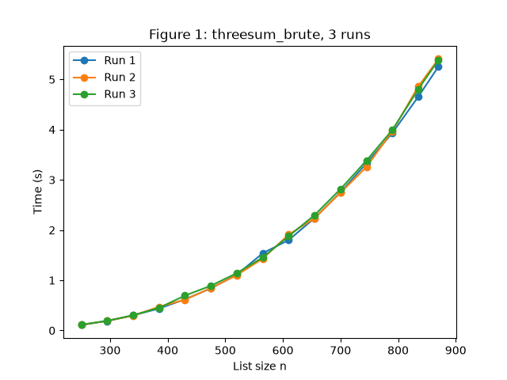
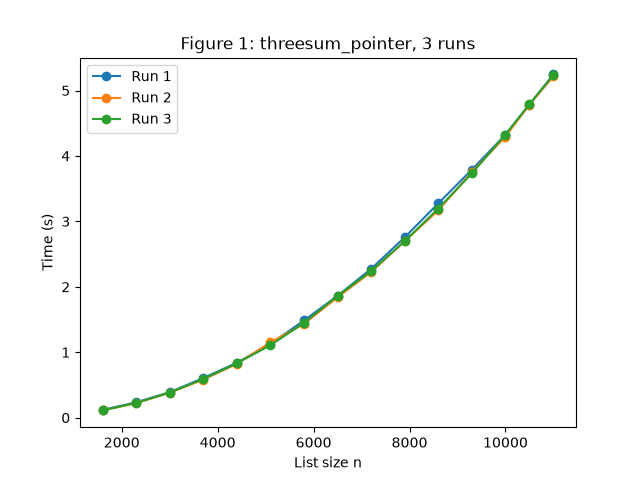
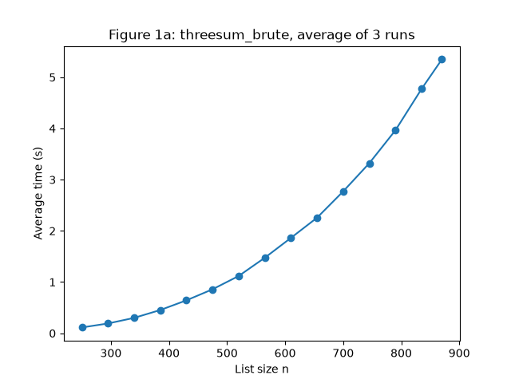
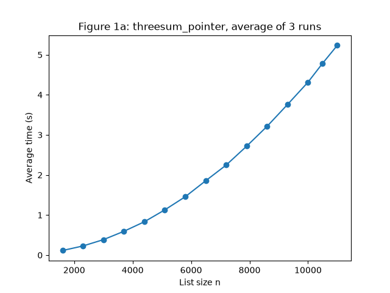
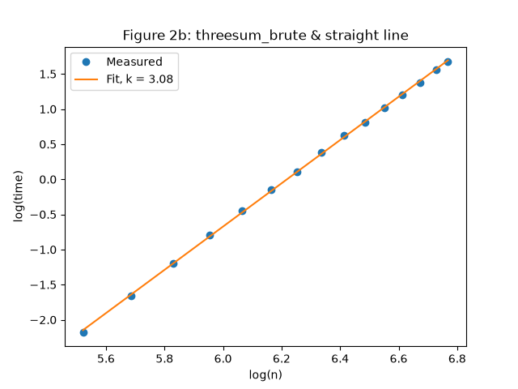
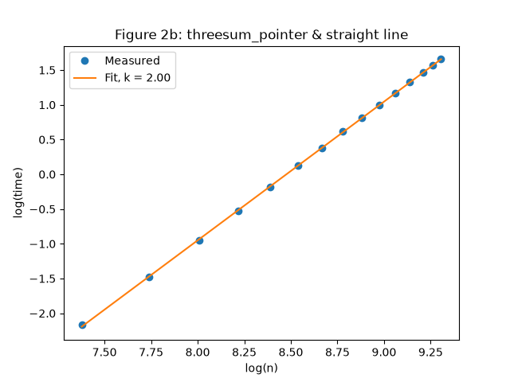

# Part 1

`uv` has been used for the environment. I chose it because I already have experience with it from earlier work and continuing using it was straightforward.

In order to run the tests and experiments run:

`uv sync`

`uv run src/part_1/main.py`

## 1. Explain how you conducted your experiments.

For the experiments I started by creating a helper function (`generate_list`). The function accepts an argument of how long the returning list should be. That length is then used as a range [−10n, 10n] when generating random numbers.

Correctness was checked with the `run_part1_tests` function. The test runs three times. Each time, one random list of 15 numbers is generated, and both `threesum_brute` and `threesum_pointer` are run on that same list. Both results are sorted and printed one below the other so they can be compared directly. I also checked the lists by hand to confirm that every printed triple sums to 0 and that no valid triple was left out.

Finding the range of sizes that would take between 0.1s and 5s has been done by using the helper function below which uses `generate_list` to create the input. I changed the list of sizes and reran the loop until the running times fell between 0.1s and 5s.

```py
for n in [100, 200, 300, 400, 500, 600]:
    lst = generate_list(n)
    start = time.perf_counter()
    alg_tested(lst)
    print(n, time.perf_counter() - start)
```

The 15 values for 0.1s up to 5s are hardcoded in the `experiments.py` file.

When measuring the time in the beginning I have used `time.time()` as used in the slides from lecture one but after some further research I have found `time.perf_counter()` to be more reliable/correct.

Figure 1 shows that three consecutive runs of the algorithms produced almost identical curves with only some minor variation between them. This suggests that the measurements are reliable for further experiments.

Each run used a new random list for every size. The average of the three runs was then used for all further figures and for the regression which reduces the effect of random timing noise from the computer and of individual lists that happen to be unusually fast or slow.

|                      Brute force                      |                         Pointer                         |
| :---------------------------------------------------: | :-----------------------------------------------------: |
|  |  |

## 2. Explain your results and comparisons.

Since the sizes for both algorithms have been chosen based on how much time it takes for them to complete, the figures and slopes end up looking similar. The difference however is that the sizes for the brute force experiment need to be much smaller than the sizes for the pointer algorithm in order to achieve the same time.

The curves for both algorithms bend upwards meaning that the time complexity grows faster than linearly. The curve for the pointer algorithm bends noticeably less than the curve for the brute_force does, hinting that the pointer has a lower time complexity. However since the two algorithms are measured on different input sizes the visual comparison is only an indication.

|                        Brute force                         |                           Pointer                            |
| :--------------------------------------------------------: | :----------------------------------------------------------: |
|  |  |

In order to make the slope equal to the exponent k, I have applied log(n) and log(T) as arguments for the `lin_reg` function. This gives the exponent k which tells the time complexity of the algorithm rather than how many more seconds my computer takes for each extra number added to the input list.

|                      Brute force                       |                         Pointer                          |
| :----------------------------------------------------: | :------------------------------------------------------: |
|  |  |

## 3. Show how you mathematically arrived at your results.

Assume the running time grows like $T = c * n^k$. Here $c$ depends on how fast the computer is and $k$ is the number I want to find.

Taking the log of both sides turns the curve into a straight line: $log(T) = log(c) + k * log(n)$. So the slope of the line is $k$ and the computer's speed ($c$) only moves the line up or down. I ran linear regression (least squares) on the log values of the average times with my `lin_reg` function to get $k$ and got:

| Algorithm   | k    |
| ----------- | ---- |
| Brute force | 3.08 |
| Pointer     | 2.00 |

`k` tells how fast the time grows when the input gets bigger. Brute force matches $O(n^3)$ and the pointer algorithm matches $O(n^2)$.

Brute force has three nested loops that try every combination so the work is $n *  n * n = n^3$. Doubling $n$ gives $2^3 = 8$ times more work. The pointer algorithm first sorts the list ($n \log n$). Then for each number the two pointers move across the list ($n * n = n^2$) so doubling $n$ gives $2^2 = 4$ times more work.

Both measured values match the expected complexities.

## 4. Explain (in an appropriate manner) how your choice of pointer works.

The pointer algorithm starts by sorting the list. This needs to be done so that moving to the right element always gives a bigger (or equal) number and moving to the left element gives a smaller (or equal) value. This tells the pointers which way to move to make the sum bigger or smaller.

After sorting the list the algorithm loops over it taking each element in turn as the **first number**. For each **first number** the left pointer starts at the element right after it and the right pointer starts at the last element of the list. The pointers then move towards each other in a loop until they meet.

At each iteration the numbers are added together and:

- If the total is less than sum the left pointer moves one step to the right to pick a larger number.
- If the total is greater than sum the right pointer moves to the left to pick a smaller number.
- If the total equals sum then all the three values are appended to a list and the pointers move inwards to look for the next pair.

When the pointers meet, every pair for the **first number** have been checked. The loop then moves to the next **first number** and resets the left pointer to the element after it and the right pointer to the last element.

Since the algorithm is looping through a sorted list the numbers in each found triple are always picked in increasing order. Returning a `set()` removes duplicates and the results are unique as required by the assignment.
