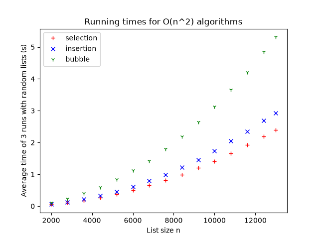
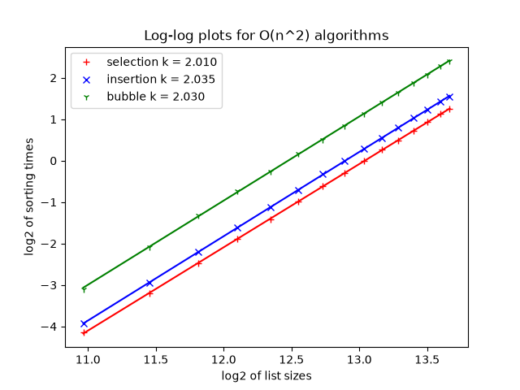
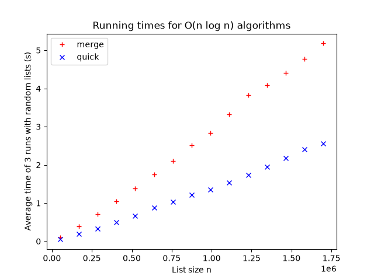
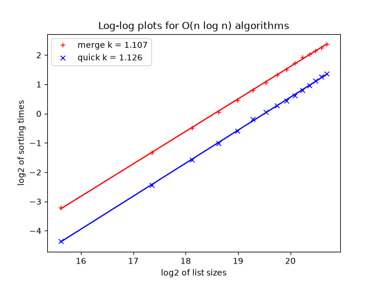
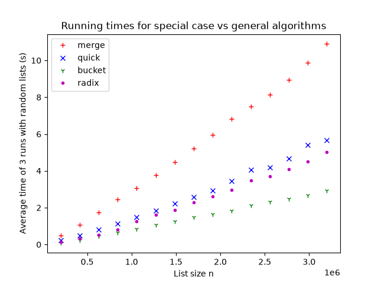
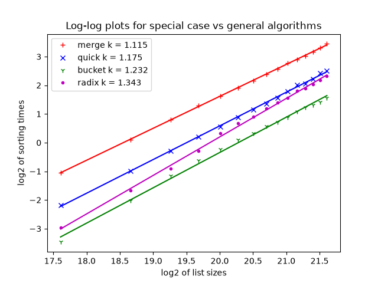

# Part 2

## 1. Explain how you conducted your experiments.

In order to run the experiments run:

`uv sync`

`uv run src/part_2/main.py`

The lists were generated using the same function as in Part 1 (random integers in [−10n, 10n]). The sorting algorithms start by making a copy of the input list and work on that so that the original input list is never changed as required by the assignment.

As in part 1 each input size was timed 3 times (each time with a new random list) and the average was used for both the running-time graphs and the log-log regression graphs.

I have divided the algorithms into three groups. All algorithms in the same group were timed on the same input sizes so that the comparison is fair. The groups are:

- $O(n^2)$ algorithms
- $O(n ⋅ log(n))$ algorithms
- Special algorithms

I used the same helper function (`generate_list()`) and the timing function from part 1 for finding suitable sizes taking from 0.1s to 5s. The sizes are hardcoded in the `On2_experiments.py`, `O_nlog_experiments.py` and `special_experiments.py` files.

## 2. Explain your results and comparisons.

The experiments show a clear difference between the $O(n^2)$ algorithms and the other algorithms.

### **$O(n^2)$ algorithms**

As expected the running time increases with the input size for all three algorithms. At the largest size Bubble sort took about 5s while Insertion sort took about 2.9s and Selection sort about 2.4s. Bubble sort being clearly the slowest about twice as slow as the other two. This is because it swaps neighboring elements many times per pass while Selection sort for example only does one swap per pass.

The log-log regression gave Selection sort k = 2.010, Insertion sort k = 2.035 and Bubble sort k = 2.030. Bubble sort is about twice as slow at every size but when n doubles, all three algorithms take about 4 times longer which gives the same k. All three are very close to 2 and the lines in the log-log plot are almost parallel confirming that all three are $O(n^2)$. The difference between them is a constant factor (the height of the line) not the growth rate.

|                                Running times                                |                             Log-log plot                             |
| :-------------------------------------------------------------------------: | :------------------------------------------------------------------: |
|  |  |

### **$O(n ⋅ log(n))$ algorithms**

Both algorithms grow almost linearly. At the largest size Quick sort took about 2s and Merge sort about 5s even though both are $O(n ⋅ log(n))$. The lines in the log-log plot are almost parallel (Merge sort k = 1.107, Quick sort k = 1.126) so the difference is a constant factor and not a different growth rate. The difference is likely because each step of Merge sort does more work (index handling and comparisons) than the simple loop in Quick sort.

|                                 Running times                                  |                              Log-log plot                               |
| :----------------------------------------------------------------------------: | :---------------------------------------------------------------------: |
|  |  |

### **Special algorithms**

Bucket sort was the fastest (about 3s at the largest size) followed by Radix sort (about 5s) Quick sort (about 5.5s) and Merge sort (about 11s). Bucket and Radix sort are faster because they place elements directly based on their value instead of comparing them which only works because the inputs are integers in a known range.

Their k values (Bucket 1.232, Radix 1.343) were higher than for Merge (1.115) and Quick (1.175). This does not mean they are slower, k only describes how fast the time grows not how long it takes. Bucket and Radix sort were the fastest at every size but their advantage gets smaller as n grows.

Because Radix sort's k is higher than Quick sort's the two lines are getting closer and for larger inputs Radix sort would become slower than Quick sort.

|                                    Running times                                    |                                 Log-log plot                                 |
| :---------------------------------------------------------------------------------: | :--------------------------------------------------------------------------: |
|  |  |

## 3. Show how you mathematically arrived at your results.

The same method as in part 1 was used. Assuming $T = c ⋅ n^k$ and taking the log of both sides gives a straight line, $log(T) = log(c) + k ⋅ log(n)$ where the slope is $k$. I ran linear regression (least squares) on the log values of the sizes and the average times to get $k$:

| Algorithm | k     |
| --------- | ----- |
| Selection | 2.010 |
| Insertion | 2.035 |
| Bubble    | 2.030 |
| Merge     | 1.107 |
| Quick     | 1.126 |
| Bucket    | 1.232 |
| Radix     | 1.343 |

If n doubles the time grows by $2^k$. For the $O(n^2)$ algorithms ($k ≈ 2$) that is about 4 times longer while for Merge and Quick sort ($k ≈ 1.1$) it is only about 2.1 times longer.

Merge and Quick sort get $k$ slightly above 1. Their work is $n$ times the number of levels ($log_2(n)$, the number of times the list can be halved). When n grows both the number of elements and the number of levels grow. For my sizes n grows 34 times and the number of levels grows from about 16 to 21, so the time grows a bit faster than linear.

Radix sort is $O(d ⋅ n)$ where $d$ is the number of digits. Since the values used in the experiment are in $[−10n, 10n]$ $d$ grows from 7 to 8 digits over my sizes which adds to its $k$.

## 4. Explain (in an appropriate manner) how each type of sorting algorithm works.

### Selection sort

The idea is that it finds the smallest value and swaps it into the right place. It loops through the list and keeps track of the smallest element found updating which one is the smallest while it iterates through the list. At the end of the list it takes the smallest value found and swaps it with the first unsorted element. It then repeats the process of finding the smallest of the remaining unsorted values switching the next smallest value into the second position. It continues until the end of the list. The key idea is that it searches first and then swaps.

### Bubble sort

It makes repeated passes over the list, compares neighboring elements (two at a time) and swaps them so that the higher value of the pair is moved to the right. In this way the largest values "bubble" to the end of the list.

### Insertion sort

It treats the first element as sorted and goes to the next one. Then it compares the second element with the first element. If the second element is lower than the first one it "picks up" that element, moves the first element to the right and "inserts" the second element into the first position. For each following element, it "picks up" the element and compares it with the sorted part starting from the right. Every element that is larger than the picked-up value is moved one step to the right. When it reaches an element that is smaller than or equal to the picked-up value it places the picked-up value in the free position.

> [!info]
> Selection sort, bubble sort and insertion sort are done using loops inside loops, each running about n times making them $O(n^2)$ algorithms.

### Merge Sort

It is a divide and conquer algorithm. It divides the list in halves (until single or no elements are left) and then merges the halves into a larger sorted list. It then repeatedly merges pairs of sorted lists into larger sorted lists by comparing their front elements and taking the smaller one each time. The sorting happens during the merging not the splitting.

### Quick sort

It is also a divide and conquer algorithm but it divides by value (pivot) and not in the middle. It partitions the other values around that pivot. Values smaller than the pivot go to the left list, values equal to the pivot go to a middle list, and larger values go to the right list. This process is repeated recursively for the right and left lists. After that it adds the left list and the right list with the middle list (pivot) between them.

This is the counterpart to the merge step. Once you've partitioned, the pivot is in its final position in the sorted list. Nothing to its left is greater than it and nothing to its right is smaller so it will never move again. Every partition call locks the pivot permanently into place.

> [!info]
> Merge sort splits the list in half and Quick sort roughly in half when the pivot is good. This gives about $log_2(n)$ levels of splitting and each level handles all $n$ elements once which gives $O(n ⋅ log(n))$.
>
> The difference between the two is in the worst case. Merge sort always splits in the middle, so it is $O(n ⋅ log(n))$ every time. Quick sort depends on the pivot: if the pivot is always the smallest or largest value one side is empty and it degrades to $O(n^2)$.

### Bucket sort

The idea is that it puts elements into different buckets and then sorts each bucket separately. It first **sets up** a list of empty buckets (as many buckets as there are elements). Then it **scatters** the elements into their corresponding buckets based on an indexing formula. It then **sorts** each non-empty bucket. Last it traverses the buckets in order and **gathers** all elements back into a list. It is a good choice when the data is evenly distributed over a known range.

### Radix Sort

It is a sorting algorithm that sorts elements by looking at digits instead of comparing the entire number values. It groups elements into buckets according to each digit position (Least Significant Digit to Most Significant Digit or vice versa) and then gathers them back in order. It is efficient for sorting large sets of integers when the number of digits is limited but it does not take into consideration negative numbers in the same way as other algorithms.

In my implementation the negative numbers are handled by splitting the list into negative and non-negative numbers. The negative numbers are made positive (the `-` sign is removed) so that both parts can be sorted with Radix sort. After sorting both parts, the negative numbers get their `-` sign back, are put in reverse order and are placed before the non-negative part.

> [!info]
> Previous sorting algorithms (Selection Sort, Bubble Sort, Insertion Sort, Merge sort and Quick sort) work on any type of keys (integers, strings, floats, or custom comparable objects) by **comparing** elements. Bucket sort and Radix sort instead place elements based on their value, which can give close to linear time like $O(n)$ for Bucket sort with evenly distributed data and $O(d ⋅ n)$ for Radix sort.
